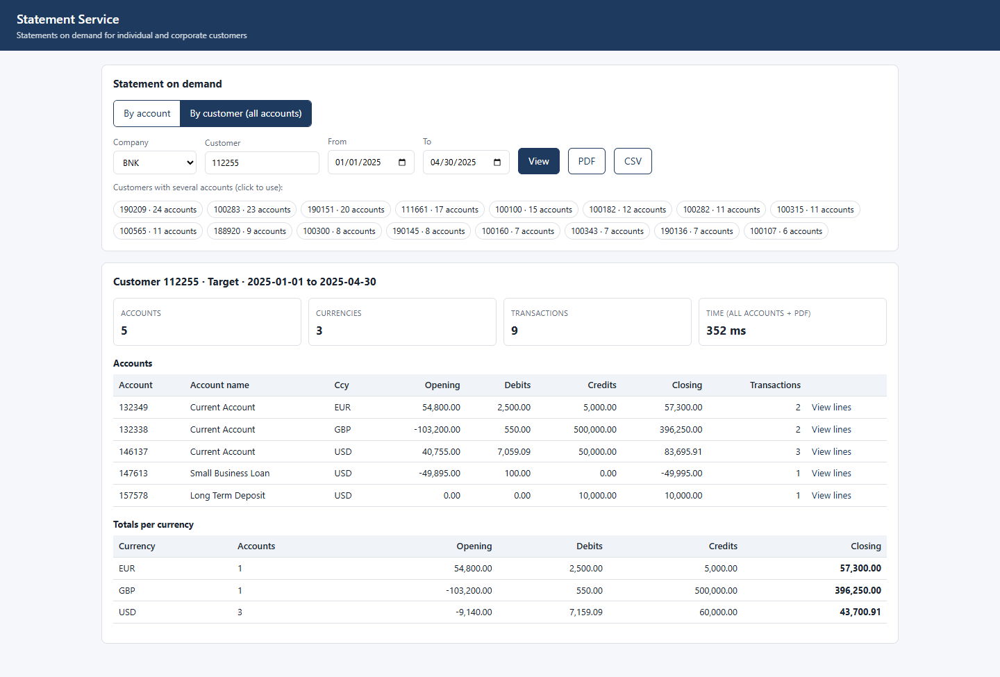
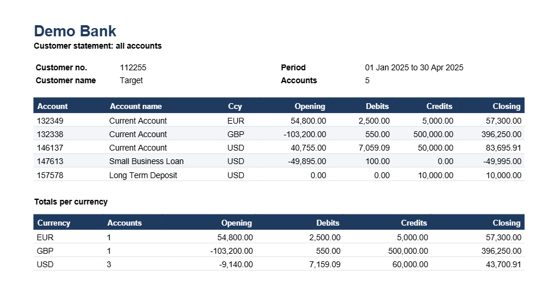
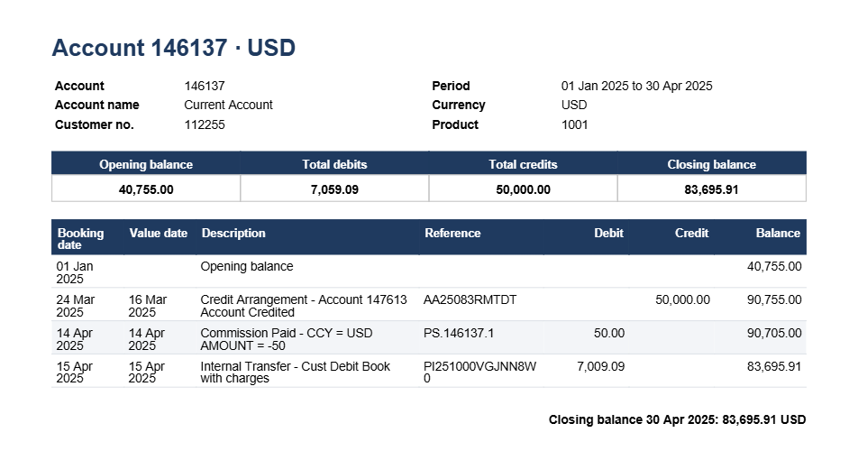
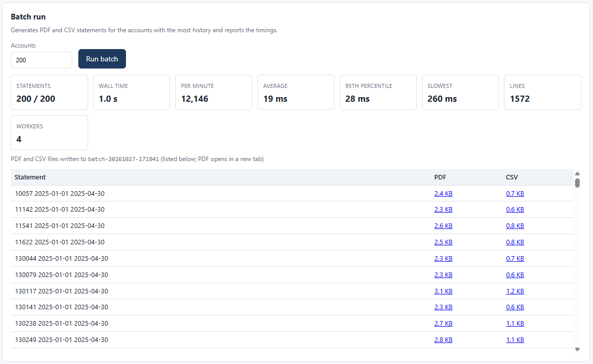

> Exported from the Claude Doc on 28 Oct 2026 (rev 227). The Claude Doc is the master copy; re-export after changes.

# Customer Statement Generation Solution — T24 R21

Oct 27, 2026 · @Clayton

**Solution proposal** for review by the bank's business, IT, T24, DBA, network and security teams.

## Executive summary

We recommend a high-throughput **Statement Service** that runs alongside T24 and reads the T24 Oracle database directly through a read-only user, instead of building statements inside the T24 application. It is designed to outperform the standard T24 statement solution at the bank's account volumes, and it reuses existing infrastructure wherever possible.

The standard solution struggles at scale because T24 itself builds every statement: enquiries run on the same application servers as live transactions, and bulk statements compete for the COB window. The proposed service moves that work off the T24 application servers, reads by key directly from the T24 database through a read-only user, generates statements in parallel, and stores closed-period statements so they are never rebuilt.

In short: **faster and more reliable statements for every customer, built on infrastructure the bank already owns.** For this phase the bank provides one UAT environment: a single server (8 vCPU, 16 GB RAM), 10–20 GB in an existing Oracle instance and about 100–200 GB of file storage; no database copy and no new database licence are needed.

Key commitments:

- **Faster:** key-based reads and parallel generation, proven in a side-by-side benchmark against the standard T24 solution before full build. Pass mark: faster than the standard solution on every sampled account, and a 12-month statement for the heaviest account within \_\_\_ seconds.
- **More reliable:** no dependency on T24 application capacity or the COB window; balances reconciled with T24 before statements are released.
- **Scales with account growth:** capacity grows by adding service instances, not T24 capacity.
- **Existing infrastructure first:** the T24 database (read directly, no copy), job queue, file storage, gateways and delivery channels reuse what the bank already runs. The only new component is compute for the service itself, justified below.
- **Focused first release:** on-demand PDF and Excel statements for individual and corporate customers through branches and internet banking, plus scheduled e-statements. Corporates get consolidated statements across all their accounts from day one. Bank file formats for corporates (SWIFT MT940/942, camt.053, SFTP), large bulk runs and serving other T24 databases follow in later phases, once the first release has proven itself.

**What the bank is asked to approve now:** Phase 1 only: one UAT server, a read-only database user on the T24 UAT database, and the side-by-side benchmark against the standard T24 solution. Full build goes ahead only if the benchmark meets the pass mark.

**How to read this document:** Part 1 (up to *Open points and next steps*) is written for management and business readers: the problem, why this solution, the infrastructure it needs and how it goes live. Two sections in Part 1 also set out the logic for technical readers: *Why not use STMT.ENT.BOOK* and *How the service builds a statement, step by step*. Part 2 holds the full technical design for the bank's IT, T24, DBA, network and security teams. Technical terms are explained in the Glossary at the end.

## Why choose this solution

Banks choosing a statement solution weigh four things: risk to T24, speed, proof that it works, and how easily the solution grows and is maintained. This section shows how this solution answers each, and how it compares with the other approaches the bank may be offered.

### One-page summary

| What the bank needs | What this solution offers |
| --- | --- |
| Fast, reliable statements | Key-based reads and parallel generation outside T24, proven on the bank's own slowest accounts before full build |
| No risk to T24 | Read-only access; no T24 code, COB jobs or local changes; T24 application servers are not used |
| Small footprint | One UAT server, a small schema on an existing Oracle instance, built on open-source components |
| Proven before full build | Already tested end to end on a T24 test system; a Phase 1 benchmark in UAT then runs the bank's slowest real statements side by side with T24; full build only once it beats them |
| Easy to maintain | Standard open-source Java components, templates changed by configuration, fields read by name with an automated check after every T24 upgrade |
| Room to grow | The same software serves production, DR, corporates and other T24 databases; capacity is added only when measured |

### Comparison with other approaches

| Approach | Strengths | Limits for this bank | How this solution compares |
| --- | --- | --- | --- |
| Tune the standard T24 statement solution | No new software | Still runs on T24 application servers and in the COB window, so gains are limited at the bank's volumes | Moves the work off T24 entirely |
| Temenos add-on statement or e-statement modules | Vendor-supported; fits the T24 roadmap | Licence and upgrade costs; may still build statements inside T24 or need extra Temenos infrastructure | Read-only, no new licence; can read through Temenos Data Hub if the bank prefers. If the bank already licenses such a module, we reuse what it covers |
| Packaged statement and customer-communication software | Strong templates and branding; many channels | Licences per volume or per core; someone still has to extract and prepare the T24 data correctly, which is the hard part | Does the T24 data work itself, and can feed the bank's existing communication software instead of producing PDFs, if the bank has one |
| Reporting tools on a database copy | Familiar and quick to start | Not built for millions of statements, T24 balance logic, delivery or reconciliation; slow on large accounts | Purpose-built for statements: T24 balance logic, key-based reads, delivery and daily reconciliation |
| Build statements inside T24 (Browser screens, enquiries and local routines) | Familiar to staff; no new server | Runs on the same servers and database as live banking; long statements time out; local code to retest at every T24 upgrade | Staff still start from T24 Browser, but the statement is built outside T24 |

### Why not build it inside T24 Browser

Staff keep starting from T24 Browser; only the building of the statement moves out of T24. Building it inside T24 would put the heaviest work back where today's problem comes from.

| Concern | Built inside T24 (Browser screens, enquiries, local routines) | This solution |
| --- | --- | --- |
| Effect on live banking | Every statement runs on the T24 application servers and the live database, next to teller, channel and COB work | Runs on its own server and reads the T24 database directly by key, read-only; the T24 application servers are not touched and the database load is capped |
| Large accounts and long periods | The enquiry builds each line through the T24 application; long ranges on busy accounts are slow and hit Browser session timeouts | Reads entries by key and streams the output; only the entries inside the requested range are read, so long ranges on busy accounts do not time out |
| Corporates with many accounts | One enquiry per account, assembled by hand | One request returns all of a customer's accounts, with totals per currency, in one PDF or Excel file |
| Month-end bulk | Tied to COB jobs and the end-of-day window | Runs after COB, in parallel, under a load limit the bank sets on the database |
| Growing capacity | More T24 application capacity, inside the core change process | Add workers to the statement server; T24 is unchanged |
| T24 upgrades | Local routines and enquiries must be rebuilt and retested on every upgrade | No code in T24; fields are read by name and checked automatically after each upgrade |
| Making changes | Every template or format change is a T24 change with COB regression testing | Template and format changes are configuration on the statement server |
| Output | Screen or print view; PDF only through Delivery mapping | PDF, Excel and CSV now; MT940/942 and camt.053 later |

What stays in T24: the Browser drill-down that opens the statement for a customer or account, the statement frequencies in `ACCOUNT.STATEMENT`, the `STMT.ENT.BOOK` enquiry (unchanged and still available to staff), and the SWIFT MT940/942 messages T24 already sends. The service can take over those SWIFT messages in a later phase if the bank chooses. The T24 change is limited to the drill-down and a read-only database user (see T24 changes).

### Already tested

A working build of the service was tested end to end on 27 Oct 2026 against a T24 test system on Oracle. That system stores its data the same way as R21. Every result below was produced read-only, with no T24 code, enquiries or COB changes.

| Test | Result |
| --- | --- |
| One account statement, on screen and as PDF | Under half a second, PDF included |
| One customer, 5 accounts in 3 currencies | About 0.35 seconds for all accounts, with totals per currency |
| Largest customers, 100 and 143 accounts (up to 4 currencies) | About 0.65 seconds each, PDF of every account included |
| Batch of 200 statements, PDF and CSV | About 1 second with 4 workers, 0 failures |
| Balances | Every statement anchored to the account's live T24 balance, so closing balances agree with T24 |

Screens from the test:

*One customer, all five accounts in one statement, with totals per currency, produced in about a third of a second.*

*The same statement as a PDF: the summary page lists every account and the totals per currency.*

*Each account then follows on its own page, with opening balance, transactions and closing balance.*

*A batch of 200 statements (PDF and CSV) in about one second, with no failures.*

The test system holds far less data than the bank, so these figures show the approach works; they are not the bank's numbers. The Phase 1 benchmark on the bank's own slowest accounts is still the gate for full build.

## The solution at a glance

&#91;embedded content: target architecture · T24, ODS, Statement Service, channels\]

A new Statement Service runs beside T24. It reads the T24 database directly through a read-only user, without going through the T24 application, builds statements, and delivers them through the channels the bank already uses.

### How it works, in plain terms

Think of T24 as the bank's busy main office. Today, every statement request is handled by that same office, so statements slow down live banking and live banking slows down statements. The new design sends statement work to a separate "reading room" that reads the same records directly, without taking the office's clerks away from customers.

1. **A statement is requested:** a customer in internet or mobile banking, a branch officer, or the monthly schedule asks for a statement for a customer or an account.
2. **The Statement Service takes the request:** a new application running beside T24, not inside it.
3. **It reads the records directly:** it looks each record up in the T24 database by its key, through a read-only user, never through the T24 application, so tellers and channels are not slowed down. A limit set by the bank's DBAs caps how much database capacity it can use.
4. **It builds the statement:** all of the customer's accounts in one document, with balances checked against T24 before release.
5. **It delivers it:** download or email in the first release, and SFTP or SWIFT for corporates in a later phase, using channels the bank already has. A copy is kept, so asking again for the same past month is instant.

### What changes for each group

| Who | What they see |
| --- | --- |
| Customers | Faster, consistent statements in internet and mobile banking and by email; one statement covering all their accounts |
| Branch staff | A statement button from the T24 customer or account screen; print or email in seconds |
| Corporate clients | Consolidated statements across all their accounts, plus files in standard banking formats (MT940, camt.053) in a later phase |
| Operations | A Statement Console to monitor month-end runs, fix failures and re-send statements |
| IT | A new service on existing platforms; no changes to how T24 itself runs |

## Problem statement and objectives

The bank already uses the standard statement solution that comes with T24, but it does not retrieve statements reliably or quickly enough at the bank's account volumes. Typical causes in T24 R21 environments are:

- Enquiries such as `STMT.ENT.BOOK` timing out on accounts with heavy transaction volumes.
- Opening and closing balances that don't match because of back-valued or forward-dated entries.
- Older periods unavailable because `STMT.ENTRY` records have been archived.
- No self-service or scheduled delivery, so statements depend on manual branch requests.

The solution must:

1. Generate accurate statements for any requested period, including archived history.
2. Serve individual and corporate customers, including multi-account and multi-currency statements.
3. Deliver through all channels: branch, internet and mobile banking and email, and for corporates SFTP and SWIFT (these two in a later phase).
4. Scale with transaction growth without degrading T24 online or COB performance.
5. Provide auditability and security for every statement produced.

## Why not use STMT.ENT.BOOK

`STMT.ENT.BOOK` is the standard T24 enquiry that lists an account's statement entries by booking date. Staff run it in T24 Browser today, and it is the main way the bank produces ad-hoc statements. It works well for short date ranges on ordinary accounts. It struggles in exactly the cases this proposal is about: long ranges, busy accounts and customers with many accounts.

**Why it slows down and times out**

- **It runs inside T24.** The enquiry runs on the T24 application servers, in the user's Browser session, using the same servers and database connections that process live banking. Every long statement takes capacity from tellers, channels and the close of business (COB).
- **It builds every line through the enquiry layer.** For each entry, T24 runs the enquiry's selection, field conversions and any local routines. On an account with tens of thousands of entries a year, that work grows with every line.
- **It assembles the whole result before showing it.** A 12-month range on a busy account can run past the Browser or application-server timeout. The user then gets nothing at all, not a partial statement, and the work done so far is lost.
- **It has no queue and no protection.** One account, one request at a time, results paged for the screen. When many staff run long statements at once, for example at month end or for audit requests, the load lands directly on the core.

**What it cannot do**

- One statement across all of a customer's accounts, with totals per currency.
- Bank-branded PDF or Excel output; its output is meant for the screen or a printer.
- Batch generation, scheduling or stored copies: the same statement is rebuilt every time it is asked for.
- Delivery to internet banking, email or corporate systems.

**Why tuning it is not enough**

New indexes, longer timeouts or more T24 application servers can push the limit further out, but the work still runs inside T24, on the core's capacity, and every line is still rebuilt on every request. Changing the enquiry or its routines also adds local code to carry through every T24 upgrade.

**How the Statement Service differs**

|  | STMT.ENT.BOOK enquiry | Statement Service |
| --- | --- | --- |
| Where it runs | Inside T24, on the core application servers | On its own server, outside T24 |
| Database it reads | The live T24 database | The same database, read directly by primary key through a read-only user; the T24 application is not involved |
| How it finds entries | Enquiry selection and per-line processing | Direct reads by the same keys T24 uses, in batches |
| Long ranges on busy accounts | Can time out and return nothing | Reads only the entries in the range; heaviest accounts tested in the Phase 1 benchmark |
| Customer with many accounts | One account at a time | One statement across all accounts, totals per currency |
| Output | Screen or printer | PDF and Excel (CSV for data); bank file formats later |
| Repeat requests | Rebuilt every time | Closed periods built once and served from storage |
| Effect on live banking | Shares the core's capacity | None on the T24 application servers; light key reads on the database, capped by a limit the bank sets |

**Same figures, different route.** The service reads the same records that the enquiry and T24's own statement printing use: `ACCOUNT`, `ACCT.STMT.PRINT`, `STMT.PRINTED` and `STMT.ENTRY`. It does not calculate anything T24 has not already booked; it reads the booked entries faster and outside the core. That is why the Phase 1 benchmark compares its statements line by line with `STMT.ENT.BOOK` and with T24's printed statements. The enquiry itself stays available to staff, unchanged.

## How the service builds a statement, step by step

This is what happens when someone asks for a statement, for example a branch officer asking for a customer's statement from 1 January to 31 March across all of the customer's accounts. Internet banking requests and scheduled runs follow the same steps. Every step only reads; nothing is ever written to T24.

&#91;embedded content: statement build · 10 read-only steps, 1 balance check\]

Read it top to bottom: each step is on the left and the T24 table it reads is on the right. A closed-period statement that was built before skips straight to delivery (dashed line). After step 6, a statement whose two balance calculations disagree, or that lists an entry T24 cannot find, is held for operations instead of being released.

Many statements are built side by side on a pool of workers, so throughput grows with the number of workers instead of with the length of the queue.

**How the balances are worked out and checked**

The service never stores or invents a balance. It derives the balances from T24's own figures in two independent ways, and they must agree:

- **Back from the current balance** (used in the tested build): closing balance = the account's current balance in `ACCOUNT` minus everything booked after the end date; opening balance = closing balance minus everything booked inside the period.
- **Forward from the last statement** (added for production): `ACCT.STMT.PRINT` holds the balance at each statement date; opening balance = the balance at the last statement date before the start date plus the entries booked between that date and the start date.

If the two disagree, the statement is held and flagged to operations instead of being released, so a missing or archived entry can never produce a wrong statement without anyone noticing.

**Why it is fast**

- Every read is by primary key, the way T24 itself reads its tables: no table scans and no new indexes.
- Only the periods and entries inside the requested range are read.
- Field positions are looked up once from `STANDARD.SELECTION` and cached, so fields are read by name without per-line overhead.
- The work runs on the service's own server, and reads the database by key instead of through the T24 application, so it neither waits for nor slows down live banking; a database limit caps its share.

**The fine details the service gets right**

Statements are only trusted if the edge cases are right. These rules are built in, and most were exercised in the tested build:

- **The account's own currency.** For a foreign-currency account the amount comes from the entry's foreign-currency field (`AMOUNT.FCY`); for a local-currency account from `AMOUNT.LCY`. One account statement never mixes currencies, and customer totals are kept per currency.
- **Booking date decides the period.** An entry belongs to the period in which it was booked, whatever its value date. A back-valued entry booked in April for a March value date appears in April, with its value date shown, so the statement agrees with T24's balances. An entry booked after the end date is left out of the closing balance even if its value date falls inside the period.
- **Reversals.** A reversed entry and its reversal both appear, the reversal marked as such, so the statement matches T24's books and the pair nets to zero.
- **A fixed order.** Lines are sorted by booking date, then value date, then entry ID. The same statement printed twice has the same order and the same running balances.
- **No double counting.** An entry listed both in the open period's `STMT.PRINTED` record and in `ACCT.ENT.TODAY` is counted once.
- **Missing entries are never ignored.** An entry ID that T24 lists but that is found in neither the live nor the archive tables is counted, and the statement is held for operations instead of being released with a gap.
- **Accounts with no movement.** They still appear on a customer statement, with the opening balance equal to the closing balance and no lines, so the customer sees every account.
- **Closed and new accounts.** An account closed during the period is included up to its closing date; an account opened during the period starts from a zero opening balance. An account that cannot be read (for example, one held in another T24 company) is listed as skipped with the reason, never silently dropped.
- **Several T24 companies.** T24 keeps separate tables for each company in a multi-company set-up. Each statement reads its account's own company tables and uses that company's branding.
- **Narratives.** Each line shows the entry's own narrative and the description of its transaction code. Codes without a description show the code itself, and the Phase 1 analysis maps them so customers see the same wording as today.
- **One point in time.** Each statement is read inside one short read-only transaction, so the opening balance, the entries and the closing balance all come from the same moment, even while T24 is posting or running COB. Bulk runs start only after the `DATES` record shows COB has finished.

## Why it outperforms the standard T24 solution

The proposed service is faster because it removes statement building from the T24 application and parallelizes it; it is more reliable because a slow statement no longer competes with live banking.

| Area | Standard T24 statements | Proposed Statement Service |
| --- | --- | --- |
| Where the work runs | T24 application servers, shared with live transactions | Separate service; T24 application servers untouched |
| Data access | Enquiry layer builds each line through the T24 application | Direct primary-key reads on the T24 database, read-only |
| Concurrency | One enquiry per request; bulk tied to COB jobs | Parallel workers, accounts split across them |
| Month-end bulk runs | Inside the COB window, competing with end-of-day jobs | After COB, in parallel, within the bank's database load limit |
| Repeat requests | Rebuilt every time | Recent closed periods served from storage; older ones rebuilt quickly |
| Failures | Rerun the enquiry or the batch job | Per-account retry from the queue; one failure never stops a run |
| Load on T24 primary | Grows with every statement | Light primary-key reads only, a few dozen per statement, capped by a database limit; nothing runs on the T24 application servers |
| Output | Delivery module formats, limited PDF | PDF, Excel and CSV; MT940/942 and camt.053 in a later phase |

### Built for very large account volumes

- **Partitioned bulk runs:** month-end jobs are split by customer ID range across workers, so throughput grows with the number of workers and each customer's accounts are built and delivered together.
- **Pre-generation:** only for e-statement subscribers and corporates, whose monthly statements are generated right after COB and stored. Everyone else is served on demand, so the bank does not build and store millions of statements nobody opens.
- **Generate once:** a closed period never changes, so its statement is built once and served from storage for the retention period (3 months recommended).
- **Back-pressure:** the job queue caps concurrent reads, protecting the T24 database during peaks; an Oracle Resource Manager limit on the service's read-only user is the hard cap.
- **Streaming output:** very large corporate statements are written page by page, keeping memory flat regardless of entry count.

### Proving it before full build

Phase 1 includes a side-by-side benchmark on a sample of the bank's highest-volume accounts plus a random sample of retail accounts. The sample includes customers with the most accounts. Statements for 1, 3 and 12 months are produced through the standard T24 solution (the STMT.ENT.BOOK enquiry and T24's statement printing) and through the prototype, measuring response time, success rate and load on T24. The pass mark is set before the benchmark runs: the prototype must be faster than the standard solution on every sampled account, succeed on every account where the standard solution times out, and produce a 12-month statement for the heaviest account within \_\_\_ seconds. Full build proceeds only once the prototype meets it.

## Options considered

A Statement Service reading the T24 database directly is the only option that meets all objectives on its own; the others are kept as supporting components.

| Option | How it works | Strengths | Limitations | Role in solution |
| --- | --- | --- | --- | --- |
| 1. Standard T24 statements (current) | `ACCOUNT.STATEMENT` frequencies, COB generation, enquiries, Delivery module output | Already in place; T24 balance logic; MT940/942 for SWIFT | Slow at high volumes, shares T24 capacity, tied to COB, rigid output | Retained for statement frequencies and SWIFT MT940/942 |
| 2. Tuned enquiry over IRIS/OFS | Optimized enquiry exposed to a rendering service | Real-time, branded output | Still runs inside T24; long ranges strain production | Not used: the service reads today's entries from the database |
| 3. Statement Service reading the T24 database directly | Service reads by key from the T24 database through a read-only user and generates in parallel | No T24 application load, any range, scales out, no database copy needed | Needs reconciliation, a read-only database user and a load limit | **Recommended core** |
| 4. Third-party CCM engine | Vendor platform templates and delivers extracts | Polished output, archiving | Licence cost, new infrastructure, still needs a data source | Not proposed; can be added later for templating |

## Individual vs corporate capabilities

| Capability | Individual customers | Corporate customers |
| --- | --- | --- |
| Typical request | Recent months, on demand | Long ranges, high volume, periodic |
| Processing | Mostly synchronous | Mostly asynchronous (queued) |
| Formats | PDF, Excel | PDF, Excel/CSV, MT940/942, camt.053 |
| Statement scope | Customer level: all owned and joint accounts in one statement, or one account | Customer level: all accounts (owned, joint, related group entities under mandate), combined or separate, multi-currency |
| Delivery | Branch, internet/mobile banking, email | All of these plus SFTP host-to-host and SWIFT |
| Scheduling | Monthly e-statements | Daily, weekly or monthly per `ACCOUNT.STATEMENT` |
| Security | PDF password (e.g. ID-based) | PDF password, encrypted SFTP, SWIFT channel controls |

## What the bank needs to invest

The bank needs **application servers for the Statement Service and file storage for generated statements**. No database copy is needed: the service reads the T24 database directly through a read-only user, so no Active Data Guard or GoldenGate licence is needed. This phase covers a single environment: a UAT environment, also used for development and for the Phase 1 benchmark. Production, DR and other test environments are sized after the benchmark, using the same software.

### Servers (UAT environment)

The service can run on the bank's container platform (OpenShift/Kubernetes), where it simply takes capacity from the existing cluster, or on virtual machines (VMs).

| Component | What it does | Servers | Size |
| --- | --- | --- | --- |
| Statement Service | One application that takes requests, serves the staff console, builds statements and runs scheduled jobs | 1 VM (or the same capacity on the container platform) | 8 vCPU, 16 GB RAM, 100 GB disk |

Requests, the staff console, statement building and scheduling all run inside one application, so one server is enough for UAT and development. Production is sized after the benchmark and stays the same single application. If the bank wants high availability, a second copy of it can be added, and a lock in the database then makes sure only one copy starts scheduled runs.

### Databases

| Item | Investment |
| --- | --- |
| T24 database (read directly) | No new database and no copy. The service reads the T24 database through a read-only user (SELECT only on the listed tables), in UAT and in production; an Oracle Resource Manager limit caps its load |
| Service schema (jobs, audit, queue) | 10–20 GB for UAT on an existing non-core Oracle instance |

**Why the service needs a small database of its own:** the service only reads T24 and never writes to it. It needs a place to keep its own working records: statement requests and their status, the waiting list of jobs, month-end run progress, an index of where each statement file is stored, customer statement preferences, reconciliation results, and the audit trail. The statement files themselves stay on the NAS, not in the database.

| Option | Investment | When to choose it |
| --- | --- | --- |
| **A schema on an existing non-core Oracle instance (recommended)** | 10–20 GB of space for UAT; no new server, no new licence | Default: the bank already runs, monitors and backs up Oracle instances |
| A new pluggable database on an existing Oracle container database | Same space; Oracle 19c and later allow up to 3 user pluggable databases without an extra licence (to be confirmed against the bank's licensing) | If the DBAs prefer stronger separation from other applications |
| A small PostgreSQL server (open source) | One small VM; no licence cost | Only if no Oracle capacity can be shared; the job queue then uses the bank's existing message broker |

The database grows mainly with the audit trail, so the bank sets retention periods (for example, 7 years for audit records and 90 days for job history), and older records are archived through the DBAs' normal process.

### Storage for generated statements

For UAT, test statements are kept for 30 days, so about 100–200 GB on the bank's existing NAS is enough. Production storage depends on how many customers receive pre-generated statements (about 150 KB per statement file) and is sized after the benchmark.

### Licences

| Item | Cost |
| --- | --- |
| Active Data Guard | Not needed: the service reads the T24 database directly. Only relevant if the bank later chooses to point the service at a standby that is not already licensed. Oracle Resource Manager, used to cap the load, is part of Oracle Enterprise Edition at no extra cost |
| Application software | None: Java 21 and the frameworks used are open source |
| Operating system or platform | Only if new VMs need OS subscriptions (e.g. Red Hat), or the container platform is licensed per core |

## Serving multiple T24 databases at once

One deployment of the Statement Service can serve **several T24 databases at the same time**, for example a group's subsidiaries or separate T24 installations. There is no fixed limit in the design: the number of databases is set in configuration, and capacity grows by adding workers.

**How it works:**

- Each T24 database is registered as a separate **data source** with its own read-only connection, connection limits, time zone, COB timing, statement templates and branding, and delivery settings.
- Every request, file and audit record is tagged with its source, so data from different banks or entities is never mixed. Staff only see the entities their role allows.
- Each data source gets its own share of the job queue, so one entity's month-end run never blocks another's.
- **Multiple companies inside one T24 database** (T24 multi-company setups) are handled natively: statements are built per company, with that company's branding.

**How many databases at a go:**

| Scenario | Guidance |
| --- | --- |
| 1 database (this bank) | One server in UAT; production sized from the benchmark |
| 2–3 databases of similar size | Same deployment; add workers in proportion to total statement volume |
| More databases, or very large ones | Same software; add workers, or run a separate deployment per region for isolation |

The limit is statement volume, not the number of databases. Phase 1 measures how many statements one worker produces per hour, and that figure sizes each additional database.

**Data residency:** where regulation requires customer data to stay in-country, the same software is deployed as a separate instance in that country, with its own configuration.

## How deployment and go-live will be done

Nothing is installed on T24, so **deployment needs no T24 downtime**, and the current standard statement solution stays available as a fallback throughout.

### Steps

1. **Prepare the environment:** DBAs create a read-only user on the T24 database, a Resource Manager limit for it, and the service schema; infrastructure provides servers or cluster capacity, a NAS share and firewall rules.
2. **Install in test environments:** the service is packaged as container images (or executable files for VMs) and installed through the bank's existing release pipeline into the UAT environment.
3. **Configure:** statement templates and branding, transaction narratives, delivery channels, user roles in the console.
4. **User acceptance testing:** business users compare new statements against current statements for a sample of individual, joint and corporate customers, and sign off.
5. **Performance testing:** a full month-end run is simulated at production volume, and results are compared with the standard solution.
6. **Production installation:** done in normal hours using a rolling update, with no outage for T24 or customers.
7. **Parallel run:** for one month-end cycle, both solutions produce statements and outputs are compared before customers are switched.
8. **Phased switch-over:** branch staff first, then internet and mobile banking, then scheduled e-statements, then corporate formats.

### Rollback

If a problem appears, channels are pointed back to the standard T24 solution through a configuration change, without reinstalling anything. Customers are not affected.

### Who does what

| Team | Responsibility |
| --- | --- |
| Bank infrastructure | Servers or cluster capacity, NAS, firewall rules, monitoring |
| Bank DBAs | Read-only user, Resource Manager limit, service schema, backups |
| T24 team | Drill-down in T24, inventory of current statement routines, reconciliation sign-off |
| Project delivery team | Build, configuration, testing, deployment, handover |
| Business and operations | Templates, acceptance testing, console users, go-live approval |

### After go-live

Updates are released through the same pipeline with rolling updates and no downtime. T24 upgrades need only a regression test of the statement tables the service reads.

## Implementation roadmap

&#91;embedded content: implementation roadmap · 4 phases, 3 gates\]

Phase 1 is a short proof: read-only access to the T24 database, a prototype, and a benchmark against the standard T24 solution on the bank's own highest-volume accounts. Build continues only if the prototype beats that baseline, which also gives the figures to size the new compute. The benchmark also measures the load the service puts on the T24 database. The Statement Console's request, job and reconciliation screens arrive in Phase 2; bulk-run, re-send and template screens follow in Phases 3 and 4. Durations are indicative.

**First release (Phases 1 and 2):** on-demand PDF and Excel statements for individual and corporate customers (consolidated across all of a corporate's accounts) through branches and internet banking, scheduled e-statements, the reconciliation job and the request screens. **Later phases:** bank file formats for corporates (SWIFT MT940/942 and camt.053, SFTP host-to-host), large scheduled bulk runs (the full batch framework is added only when bulk volumes need it) and serving other T24 databases. Keeping the first release small brings it live sooner and limits the risk.

## Risks and mitigations

| Risk | Impact | Mitigation |
| --- | --- | --- |
| Prototype does not beat the standard solution | Business case fails | Benchmark in Phase 1 against measured baseline; full build only after targets are met |
| Bank policy does not allow a new application on the core database | Direct read access not approved | Point the service at a read-only copy the bank already runs (ADG standby, reporting replica or Temenos Data Hub); same reads, only the connection changes |
| Statement reads load the live T24 database | Slower tellers, channels or COB | Reads by primary key only; Resource Manager caps CPU and sessions; the queue caps concurrent reads; bulk runs only after COB; the Phase 1 benchmark measures load before go-live |
| Balance mismatches from back-valued entries | Incorrect statements | Opening balances taken from T24's own statement records; nightly reconciliation blocks release on any break |
| Very large corporate accounts | Slow generation | Async processing, streaming output, closed periods stored |
| Archived data gaps | Incomplete history | Agree the archive tables and cut-off date in the data-mapping workshop; verify coverage during the benchmark and report gaps before go-live |
| T24 table layout changes (upgrade or new local fields) | Wrong values on statements; direct table reads are outside Temenos support | Fields mapped by name from T24's field definitions (STANDARD.SELECTION), never by position; automated regression test after every T24 upgrade or local-field change |
| Very large statement records on high-volume accounts | Slow reads, memory pressure | Records read in chunks and output streamed; heaviest accounts included in the Phase 1 benchmark |
| Unclear transaction narratives | Poor corporate experience | Map transaction codes and narrative fields during design, validated with sample corporate customers |

## Assumptions and dependencies

- T24 R21 runs on Oracle (confirmed).
- The bank can create a read-only database user on the T24 database (SELECT only on the listed tables) and an Oracle Resource Manager limit for it.
- The bank has several million customers; production server and storage figures are sized from the Phase 1 benchmark, run in the UAT environment.
- The existing API gateway, email, SFTP and SWIFT interfaces, file storage and container or app-server platform can host the new workload.
- Archived statement entries are accessible for statements covering archived periods.
- The standard T24 statement solution stays in place for statement frequencies and SWIFT messages.

## Open points and next steps

The following should be confirmed with the business to finalize sizing and scope:

- [ ] Whether the bank's policy allows a read-only user directly on the T24 database, or requires the service to read a copy the bank already runs (ADG standby, reporting replica or Temenos Data Hub)
- [ ] Number of customers receiving statements each month, and how long statement files must be kept
- [ ] Whether the service must serve other T24 databases or group entities, now or later
- [ ] Which container platform or app servers can host the new service
- [ ] Whether the bank prefers Oracle Advanced Queuing or an existing message broker
- [ ] Current performance of the standard solution: slowest statement types and failure rates
- [ ] Delivery channels required at go-live
- [ ] Whether corporates need MT940/942, camt.053, or PDF/Excel only
- [ ] Whether the bank already licenses a Temenos statement or e-statement module that could meet part of the need
- [ ] Which customers subscribe to e-statements (they, with corporates, are the only ones pre-generated)
- [ ] Whether statements should follow booking date (recommended) or value date
- [ ] How T24 archiving is set up at the bank (archive tables or a separate archive database) and the archive cut-off date

Once confirmed, the next step is a short design workshop with the T24, DBA and infrastructure teams to agree the data mapping and environment setup for Phase 1.

## Part 2: Technical design (for IT teams)

The sections above are written for business and management readers. The sections below give the technical detail that the bank's IT, T24, DBA, network and security teams need to review and build the solution.

## Component design

### 1. Data layer: direct read-only access to the T24 database

- **Direct, read-only access.** The service reads the T24 Oracle database itself through one read-only user, by primary key, never through the T24 application. This is how the tested build works. An Oracle Resource Manager limit caps the user's CPU and sessions, so statement load can never crowd out tellers, channels or COB.
- **Access pattern:** reads follow the same keys T24 uses. `ACCT.STMT.PRINT` gives the statement dates and the balance at each one; `STMT.PRINTED` gives the `STMT.ENTRY` IDs of each statement period. These records exist only at statement-frequency dates, so a request for any other date range reads the periods that overlap it and keeps only the entries inside the range. Entries of the current open period are listed in the open period's `STMT.PRINTED` record, which T24 keeps under the next statement date, and entries booked today come from `ACCT.ENT.TODAY`. The tested build reads both; the bank's set-up is confirmed in the data-mapping workshop. Entries are fetched by primary key in batches. No new indexes or objects are created on T24 tables.
- **Optional: a read-only copy.** If bank policy forbids a new application on the core database, or the benchmark shows month-end load the bank is not comfortable with, the same reads run against a copy the bank already runs (an Active Data Guard standby, reporting replica or Temenos Data Hub). Only the connection changes. No GoldenGate or new copy is built.
- **Archived entries:** in R21, T24's archiving moves old STMT.ENTRY records out of the live tables into archive tables (the $ARC copies of the entry and statement files, or a separate archive database, depending on how the bank set it up). When a requested period falls before the archive cut-off date, the reader reads those archive tables by the same keys. The exact tables and the cut-off date are agreed in the data-mapping workshop, and coverage is tested in the Phase 1 benchmark.
- **Field mapping:** reading T24 tables directly is outside Temenos support, so the service maps fields inside `XMLRECORD` by name, using T24's own field definitions (`STANDARD.SELECTION`), never by position. An automated regression test compares sample statements with T24 after every T24 upgrade or local-field change.
- **Very large records:** high-volume accounts can have very large `STMT.PRINTED` records (hundreds of thousands of entry IDs). The reader processes them in chunks and streams output, and the heaviest accounts are part of the Phase 1 benchmark.
- **Load limits:** a bounded connection pool, worker throttling, bulk runs after COB, and the Resource Manager cap.

**T24 tables the service reads.** The read-only database user is granted SELECT on these tables only, for each T24 company. In the database each table is named per company (for example `F<company mnemonic>_STMT_ENTRY`) and holds a record key plus `XMLRECORD`.

| T24 table | Read by | Used for | In the tested build |
| --- | --- | --- | --- |
| `CUSTOMER` | Customer number | Name and address on the statement | Yes |
| `CUSTOMER.ACCOUNT` | Customer number | The accounts the customer owns | Yes |
| `JOINT.CONTRACTS.XREF` | Customer number | Accounts the customer holds jointly | Added in build |
| `ACCOUNT` | Account number | Title, currency, category, company and current balance (`ONLINE.ACTUAL.BAL`) | Yes |
| Closed-account records | Account number | Accounts closed during the period (exact table confirmed in the workshop) | Added in build |
| `ACCT.STMT.PRINT` | Account number | Statement dates and the balance at each one: the forward anchor | Added in build |
| `STMT.PRINTED` | Account number and statement date | Entry IDs for each statement period, including the open period | Yes |
| `ACCT.ENT.TODAY` | Account number | IDs of entries booked today | Yes |
| `STMT.ENTRY` and its archive tables | Entry ID | The entries themselves | Yes |
| `TRANSACTION` | Transaction code | Line descriptions | Yes |
| `ACCOUNT.STATEMENT` | Account number | Statement frequency, for scheduled runs | Added in build |
| `DATES` | Company | Current business date and COB completion | Added in build |
| `STANDARD.SELECTION` | Table name | Field names and positions, so every field is read by name | Yes |

### 2. Consistent reads

Each statement is read inside one short read-only transaction (SET TRANSACTION READ ONLY), so every table is seen as at one moment, even while T24 is posting or running COB: an entry is never counted twice or missed between the balance and the entry list. The transaction lasts under a second, so it puts no pressure on the database's undo space. Today's entries come from ACCT.ENT.TODAY in the same read, so no intraday call to T24 through IRIS or OFS is needed. Bulk runs start only after the DATES record shows COB has finished.

### 3. Statement Service

- Spring Boot service that keeps no state in memory between requests, so any copy can serve any request. It is one application, run as one instance in UAT. Production is sized after the benchmark; a second copy of the same application can be added behind the bank's load balancer for availability.
- **Sync API** for small requests (indicatively up to 3 months or 5,000 entries); **async queue** (Oracle Advanced Queuing, included with the bank's Oracle database, or the bank's existing message broker) for large ranges, bulk and scheduled runs, with a notification when ready.
- Balances are derived from T24's own figures in two independent ways that must agree: back from the account's current balance in `ACCOUNT` (closing = current balance minus entries booked after the end date), and forward from the balance at the last statement date in `ACCT.STMT.PRINT` on or before the start. History is never summed from the account's first entry. Statements follow booking date (the date an entry was posted), with value date shown as a column, so back-valued items appear when they were booked and totals still agree with T24. The bank confirms this rule in the design workshop.
- Handles multi-currency accounts, joint accounts and combined multi-account corporate statements.

### 4. Output formats

- PDF (password-protected) and Excel/CSV for all customers.
- MT940/MT942 and ISO 20022 camt.053 for corporates.
- Generated files are stored on the bank's existing file storage (NAS or document store), so repeat requests are served instantly and an e-statement archive builds up automatically.

### 5. Delivery

Branch UI, internet and mobile banking download, password-protected email, SFTP host-to-host and SWIFT. Scheduled e-statements follow the frequencies already configured in `ACCOUNT.STATEMENT`.

### 6. Controls

- **Nightly reconciliation:** the statement closing balance must equal the T24 balance for every account; any break blocks statement release for that account and raises an alert. Every statement is also checked as it is built: the two balance anchors must agree and no listed entry may be missing, otherwise the statement is held.
- **Audit log:** who requested which statement, for which period, through which channel.
- **Data protection:** PDF password policy, masking where required, encryption in transit and at rest.

## Solution design

The Statement Service is one codebase built as a multi-module Maven project, deployed as **one application** that does three jobs: API, worker and scheduler. Each job can be switched on or off in configuration, so a copy can later run bulk work only if month-end volumes need it.

### Service modules

| Module | Responsibility |
| --- | --- |
| `statement-api` | REST endpoints, request validation, customer and account entitlement checks, sync/async routing; hosts the Statement Console |
| `statement-core` | Statement model, customer-to-account resolution, opening and closing balance logic, consolidated multi-account and multi-currency statements |
| `statement-t24-reader` | Key-based reads on the T24 database (read-only user) of the tables listed in Component design, section 1; field positions from `STANDARD.SELECTION`; parses `XMLRECORD`; one read-only transaction per statement |
| `statement-render` | PDF (with password), Excel, CSV, MT940/942 and camt.053 writers, all streaming; customer summary pages |
| `statement-delivery` | Adapters for download, email, SFTP and SWIFT, with retries; one delivery per customer |
| `statement-worker` | Consumes queue jobs, generates and stores files, updates job status |
| `statement-scheduler` | Month-end and frequency-based runs, partitioned by customer ID range; nightly reconciliation |
| `statement-audit` | Audit trail of every request, generation and delivery |

### API endpoints

All endpoints are versioned, JSON over HTTPS, and published through the bank's API gateway.

| Method and path | Purpose | Response |
| --- | --- | --- |
| `POST /api/v1/statements` | Request a statement for a customer (all or selected accounts) or for specific accounts, with date range, layout, format and delivery channel | `200` with the file for small ranges, or `202` with a job ID |
| `GET /api/v1/statements/jobs/{jobId}` | Check job status | Status, progress, file reference when ready |
| `GET /api/v1/statements/files/{fileId}` | Download a generated statement | File stream (PDF, XLSX, CSV, MT940 text, camt.053 XML) |
| `POST /api/v1/statements/bulk` | Trigger a bulk run (operations staff only) | `202` with run ID |
| `GET /api/v1/statements/runs/{runId}` | Bulk run progress and failures | Counts by status, failed accounts |
| `GET /actuator/health`, `/actuator/prometheus` | Health and metrics (internal port only) | Health status, metrics |

### Customer-level statements

Statements are requested, generated and delivered at **customer** level, not only per account: one request for a customer covers all of their accounts, or a selected subset.

**Resolving a customer's accounts** (all reads on the T24 database, read-only):

- `CUSTOMER.ACCOUNT` gives the accounts the customer owns.
- The joint-holder cross-reference (`JOINT.CONTRACTS.XREF`) adds accounts where the customer is a joint holder. Joint accounts appear on each joint holder's customer statement, and each holder receives their own copy through their own delivery channel and password.
- Accounts closed during the requested period are included from T24's closed-account records, so a period statement is complete.
- Optional filters: product or category, currency, account status, or an explicit account list.
- For corporate groups, related customers (parent and subsidiaries, from T24 customer relationships) can be included when the requester is mandated for all of them.

**Statement layout options:**

| Format | Customer-level layout |
| --- | --- |
| PDF | One consolidated document: customer summary page (every account with opening and closing balance, totals per currency), then one section per account. Option for separate PDFs per account in one ZIP |
| Excel | Summary sheet plus one sheet per account |
| CSV | One file per account, bundled |
| MT940/942 | One message per account, as the standard requires, sent together |
| camt.053 | One message containing a statement block per account |

Totals are shown per currency; currencies are never summed together unless the bank wants a converted total, in which case the rate and date are printed.

**Rules that make customer-level work at scale:**

- **Entitlement at customer level:** the requester (customer, branch user or corporate user) must be entitled to the customer; corporate users see only accounts their mandate covers.
- **One delivery per customer:** one email with one password-protected file, instead of one email per account, which cuts email volume sharply for the bank's customer base.
- **Customer preferences:** combined or separate layout, format, delivery address and frequency are held per customer in the service schema, seeded from T24 customer and `ACCOUNT.STATEMENT` data.
- **Bulk runs partitioned by customer:** month-end runs are split by customer ID range, so all of a customer's accounts are built by the same worker and delivered together. Customers with very many accounts are split into per-account sub-jobs and merged before delivery.
- **Release only when complete:** a customer statement is released only when every included account passes reconciliation; otherwise it is held and shown in the console.

### Statement generation sequence

1. Request validated; caller's entitlement to the customer and accounts checked; for a customer-level request, the customer's accounts are resolved.
2. If the period is closed and already generated, the stored file is returned immediately.
3. Otherwise the router decides: small request runs synchronously, large or corporate request becomes a queued job.
4. Reader takes the account's current balance from `ACCOUNT`, and the last statement date and balance on or before the requested start from `ACCT.STMT.PRINT`. It gets entry IDs from the `STMT.PRINTED` records that overlap the range (the open period's record included) and today's IDs from `ACCT.ENT.TODAY`, then fetches `STMT.ENTRY` records by primary key in batches, falling back to the archive tables for IDs not in the live table.
5. Core builds the statement: running balance, narratives from transaction codes, opening and closing balances worked out from both anchors, which must agree; a disagreement or a missing entry holds the statement for operations.
6. Renderer streams the requested format; PDF is password-protected.
7. File stored on the NAS with a checksum; audit record written; file delivered or made available for download.

### Service data model

The service keeps a small schema of its own on an existing non-core Oracle instance (the service never writes to T24).

| Table | Holds |
| --- | --- |
| `CUSTOMER_STMT_PROFILE` | Per-customer preferences: combined or separate layout, format, delivery address, frequency, included accounts |
| `STMT_REQUEST` | Who requested what: customer, accounts, period, format, channel |
| `STMT_JOB` | Queued job status, attempts, errors; parent job per customer with per-account sub-jobs |
| `STMT_FILE` | File location, checksum, customer, accounts covered, period, closed-period flag, expiry |
| `STMT_RUN` | Bulk run progress by customer range |
| `RECON_RESULT` | Nightly reconciliation outcome per account |
| `STMT_AUDIT` | Immutable audit trail |
| AQ queue tables | Job queue (Oracle Advanced Queuing) |

### User interfaces

There is no new customer-facing UI. Customers use the bank's existing internet and mobile banking, which call the Statement API, and receive scheduled statements by email or SFTP. The only new screen is a lightweight internal **Statement Console** for branch and operations staff.

**Branch staff** reach the console from T24 itself: a drill-down added to an existing T24 account enquiry opens the console's statement request page with the account pre-filled. Staff pick the period and format, then print or email the statement. The only T24 change is that drill-down; if the bank already has a branch or teller portal, it can call the API directly instead.

**Operations staff** use the console to run and supervise the service:

| Function | What it does |
| --- | --- |
| Statement request | Request, preview, print or email a statement for any customer or account the user is entitled to |
| Bulk and month-end runs | Progress by customer range, failed accounts, re-run failed items |
| Job queue | View stuck or failed jobs; retry or cancel |
| Reconciliation breaks | Accounts blocked from release; release once resolved, with maker-checker approval |
| Re-send | Re-deliver a statement by email or SFTP |
| Audit search | Who requested which statement, when and through which channel |
| Templates and narratives | Manage templates and narrative mappings, with maker-checker approval |

**How it is built and deployed:**

- A web module inside the `statement-api` deployable (Spring Boot with a small React front end), so there is no new server or deployable.
- Served on the same port 8443, through an internal-only route not exposed to the internet.
- Single sign-on through the bank's Active Directory, with role-based access: branch user, operator, approver, auditor.
- Every console action is written to the audit trail.
- Metrics and alerts stay in the bank's existing monitoring tools; the console does not duplicate dashboards.

### T24 changes

The service reads T24 data directly from the T24 database, so the statement path needs no new T24 routines or enquiries.

| Item | Type | Required? | Purpose |
| --- | --- | --- | --- |
| Drill-down on an existing customer or account enquiry | Enquiry configuration (a small routine only if the Browser/Explorer setup cannot open a URL) | Required | Opens the Statement Console with the customer or account pre-filled for branch staff |
| Read-only database user on the T24 database | DBA task | Required | SELECT only, on the tables listed in Component design, section 1, for each T24 company the bank runs |

Not needed:

- No statement-building enquiries or conversion routines: customers, accounts, entries and balances are read by key.
- No new COB jobs or TSA services: the scheduler detects COB completion from the T24 `DATES` record.
- No reconciliation routine: balances are compared by reading the T24 database.

**Analysis task in Phase 1:** the bank's current statements likely rely on local routines (narrative builders, enquiry conversion routines, Delivery mapping routines). These are inventoried and their logic carried into the service, so customers see the same narratives as today. This is the main T24-side effort and is sized during the benchmark.

## Deployment architecture

The solution is designed to run on the bank's existing infrastructure. The only new component is compute for the Statement Service itself; nothing is installed on the T24 application servers or the primary database.

&#91;embedded content: deployment architecture · 4 network zones\]

Channels reach the service through the API gateway; the service reads the T24 database directly through one read-only user and keeps its own jobs and audit in a small schema on an existing Oracle instance. The T24 application servers are not used.

### Existing vs new infrastructure

| Component | Existing or new | Justification |
| --- | --- | --- |
| T24 Oracle database | Existing | Read directly through one read-only user; load capped by Oracle Resource Manager |
| Job queue (Oracle Advanced Queuing) | Existing | Built into Oracle; lives in a small service schema on an existing non-core Oracle instance, since the service never writes to T24. No new broker. The bank's existing message broker can be used instead |
| File storage for generated statements | Existing | Bank NAS or document store, with a retention policy |
| API gateway, internet and mobile banking | Existing | Statement API published through the current gateway |
| Email gateway, SFTP server, SWIFT interface | Existing | Delivery reuses current channels and controls |
| Active Directory | Existing | Single sign-on and roles for the Statement Console |
| Container platform or app server hosts | Existing where available | Service deployed as a new workload on the bank's current platform |
| Compute for the Statement Service | **New** | Statement building must run outside T24 to beat the standard solution; sharing T24 servers would recreate today's bottleneck. Sized from the Phase 1 benchmark |
| Statement Console | **New (no new server)** | Branch staff and operations need to request statements, supervise runs, clear reconciliation breaks and re-send files; it is part of the same Statement Service application |
| Read-only copy of T24 (standby or reporting copy) | **Optional** | Only if bank policy forbids direct access or the benchmark shows too much load; the service switches to it by configuration |

Reading the T24 database directly avoids a copy, a licence and a second database to run; the bank's DBA practices stay unchanged, and on-demand statements keep working while T24 runs COB.

### Request flows

1. **On-demand (small range):** channel → API gateway → Statement API → key-based reads on the T24 database → renders PDF/Excel → returns the file and stores a copy if the period is closed.
2. **On-demand (large range or corporate):** Statement API places a job on the queue → the same service picks it up in the background and generates the statement → file saved to storage → customer or staff notified with a download link.
3. **Month-end and scheduled:** after COB the scheduler reads `ACCOUNT.STATEMENT` frequencies → splits customers into ranges and resolves their accounts → workers generate in parallel and deliver via email, SFTP or SWIFT.
4. **Reconciliation:** nightly job compares statement closing balances with T24 → any break flags the account and blocks its statements until resolved.

### Environments

| Environment | Purpose | Data source |
| --- | --- | --- |
| DEV | Build and unit testing | T24 dev/test DB, masked data |
| SIT | Integration with T24, channels and gateways | T24 SIT environment |
| UAT | Business acceptance, statement accuracy sign-off | T24 UAT with production-like volumes |
| PROD | Live service | T24 production |
| DR | Failover for the application zone | T24 DR site; service fails over with it |

Deployments go through the bank's CI/CD pipeline as container images, with configuration (thresholds, templates, channel settings) held outside the code so changes don't need a release.

### Technology stack

The stack uses mainstream, open-source Java components so no new licences are needed no new licences are needed.

| Layer | Technology | Why |
| --- | --- | --- |
| Language and runtime | Java 21 LTS | Latest long-term-support release; virtual threads let each instance run thousands of concurrent database reads with little memory, which suits high-volume statement generation |
| Application framework | Spring Boot 3.3+ (Web, Security, Actuator, JDBC), virtual threads enabled | Standard for bank microservices; built-in health and metrics |
| Bulk processing | Spring Batch with partitioned steps | Splits month-end runs by customer ID range across workers, with restart from the last checkpoint |
| Database access | Oracle JDBC (ojdbc11) with HikariCP connection pooling | Native Oracle driver; pooled, bounded, read-only connections to the T24 database |
| T24 record parsing | StAX streaming XML parser | Reads `XMLRECORD` without loading whole records into memory |
| Job queue | Oracle Advanced Queuing via Spring JMS | Included with Oracle; transactional with the service schema |
| PDF | OpenPDF (used in the tested build) or JasperReports templates; Apache PDFBox for password protection | Bank-branded templates; standard PDF encryption |
| Excel and CSV | Apache POI (streaming SXSSF), OpenCSV | Writes very large statements with flat memory use |
| SWIFT and ISO 20022 | Prowide Core (MT940/942), Prowide ISO 20022 (camt.053) | Open-source, standards-validated message builders |
| Security | Spring Security OAuth2 resource server (JWT from the API gateway), TLS 1.2+ | Fits the existing gateway; no new identity provider |
| Schema migrations | Liquibase | Versioned, repeatable changes to the service schema |
| Observability | Micrometer metrics, JSON logs | Feeds the bank's existing monitoring and log platforms (e.g. Prometheus/Grafana, ELK or Splunk) |
| Build and delivery | Maven, bank's existing CI/CD and image registry | No new tooling |

### Deployment structure and packaging

The service is delivered as **OCI container images** with a **Helm chart** for the bank's OpenShift or Kubernetes platform. If the bank has no container platform, the same build ships as **executable JARs run as systemd services on RHEL VMs** behind the existing load balancer. It is not deployed onto the T24 TAFJ application servers, so T24 capacity and upgrades are unaffected.

| Deployable | Format | Instances | Scaling |
| --- | --- | --- | --- |
| statement-service (API, worker and scheduler) | Container image (or JAR on VM) | UAT: 1. Production: sized after the benchmark (a second copy only for availability) | A database lock lets only one copy run scheduled jobs; customer requests take priority over bulk jobs; more copies only if the benchmark shows a need |
| Service schema | Liquibase changelog | n/a | Applied by the pipeline before each release |
| Templates and narrative mappings | Versioned config files | n/a | Changed without code release |

On the container platform, each environment gets its own namespace (e.g. `statements-uat`, `statements-prod`) containing:

- One Deployment for the Statement Service, with readiness and liveness probes on the actuator endpoints.
- An internal Service and a TLS Route/Ingress for the API, exposed only to the API gateway.
- ConfigMaps for settings (sync thresholds, templates, channel settings).
- Secrets for database credentials and certificates, sourced from the bank's vault where available.
- A persistent volume mount for the NAS statement store.

Releases follow the bank's existing CI/CD: build and test, scan the image, push to the registry, apply Liquibase changes, then a rolling update with zero downtime.

### Network ports and firewall rules

All new rules originate from the application zone; the only new path into the core banking zone is the service's read-only database connection; nothing new reaches the T24 application servers. Ports marked "as configured" follow the bank's existing setup and must be confirmed with the network team.

| Source | Destination | Port | Protocol | Purpose |
| --- | --- | --- | --- | --- |
| Channels and clients | API gateway | 443 | HTTPS | Existing public/internal entry point |
| API gateway | `statement-api` | 8443 | HTTPS (TLS 1.2+) | Statement requests |
| Branch and operations staff (internal network) | `statement-api` console route | 8443 | HTTPS (TLS 1.2+) | Statement Console, internal only |
| `statement-api` | Active Directory / identity provider | 636 (LDAPS) or 443 (SAML/OIDC), as configured | LDAPS or HTTPS | Console sign-in and roles |
| API, worker, scheduler | T24 database | 1521 (or 2484 with TLS) | Oracle Net / TCPS | Key-based reads (read-only user) |
| API, worker, scheduler | Service schema (existing Oracle instance) | 1521 (or 2484 with TLS) | Oracle Net / TCPS | Jobs, audit, AQ queue |
| `statement-worker` | Email relay (SMTP) | 587 | SMTP with STARTTLS | Statement emails |
| `statement-worker` | SFTP server | 22 | SFTP | Corporate host-to-host files |
| `statement-worker` | SWIFT interface (e.g. Alliance Access via file drop or MQ) | As configured (e.g. 1414 for IBM MQ) | MQ or file transfer | MT940/942 and camt.053 |
| API, worker | NAS statement store | 2049 (NFS) or 445 (SMB) | NFS / SMB | Store and read generated files |
| Monitoring platform | All service roles | 8081 (internal only) | HTTP | Health checks and metrics |

The database account used on the T24 database is read-only and limited to the tables listed in the solution design.

## Non-functional design

- **Scalability:** stateless service instances scale horizontally; bulk runs are split by customer range across workers; reads are by primary key, so cost per statement stays flat as the account base and history grow.
- **Performance:** statement reads never use the T24 application servers, only light key reads on the database under a load limit; closed-period statements are generated once and served from storage.
- **Availability:** statement retrieval keeps working during T24 COB and maintenance windows because it reads the database directly, not through the T24 application; each statement reads one consistent point in time, and bulk runs wait until COB has finished.
- **Security:** role-based access for staff channels, password-protected PDFs, encryption in transit and at rest, full audit trail.
- **Observability:** metrics in the bank's existing monitoring tools for request volumes, generation times, queue depth, the service's load on the T24 database and reconciliation breaks, with alerts on each.

## Glossary

| Term | Meaning |
| --- | --- |
| T24 / Temenos Transact | The bank's core banking system, which holds customers, accounts and transactions |
| COB (Close of Business) | T24's end-of-day processing run |
| Standby database / Data Guard | A continuously updated copy of the T24 database, kept for disaster recovery |
| Active Data Guard | An Oracle option that lets the standby copy be read while it stays up to date; an option only, not needed by this design |
| Operational data store / Temenos Data Hub | A reporting copy of T24 data that some banks already run; the service can read it instead of the T24 database if the bank prefers |
| STANDARD.SELECTION | T24's own list of the fields in each table; used to read fields by name, so upgrades don't break statements |
| Booking date / value date | The date an entry was posted / the date it takes effect for interest; statements list entries by booking date |
| Enquiry / STMT.ENT.BOOK | A T24 screen report run inside T24 Browser; STMT.ENT.BOOK is the standard enquiry that lists an account's entries by booking date, used today for ad-hoc statements |
| STMT.ENTRY | T24's table of account entries: one record per debit or credit, with booking date, value date, amount and narrative |
| STMT.PRINTED | One record per account and statement period, listing the ids of the entries in that period |
| ACCT.STMT.PRINT | One record per account, holding its statement dates and the balance at each one |
| ACCT.ENT.TODAY | The ids of an account's entries booked today, before they are added to a statement period |
| XMLRECORD | The column in which T24 stores each record's fields in its Oracle tables; the service reads fields from it by name |
| Archive tables ($ARC) | Where T24's archiving moves old entries; the service reads them when a period falls before the archive cut-off |
| Statement Service | The new application that builds and delivers statements |
| Statement Console | The new internal web screen for branch and operations staff |
| API | A secure, standard way for one system (e.g. mobile banking) to ask another for something |
| Worker | A part of the service that builds statements in the background; more workers = more statements per hour |
| Job queue | A waiting list of statement jobs, so work is spread evenly and nothing is lost |
| Reconciliation | An automatic check that statement balances match T24 before release |
| MT940 / MT942, camt.053 | Standard bank statement file formats used by corporates and SWIFT |
| SFTP / host-to-host | Secure automatic file transfer to a corporate client's own system |
| NAS | Shared network storage where generated statement files are kept |
| Container / Kubernetes / OpenShift | A standard way to package and run applications so they can scale up and down automatically |
| vCPU / GB RAM | Units of server processing power and memory |
| DR (Disaster Recovery) | The secondary site used if the main data centre fails |
| Java 21 | The programming platform the service is built on |
| Oracle Resource Manager | A built-in Oracle Enterprise Edition feature that caps the CPU and sessions a database user can take |
| Read-only transaction | A set of reads that all see the database as at one moment, even while other work changes it |
